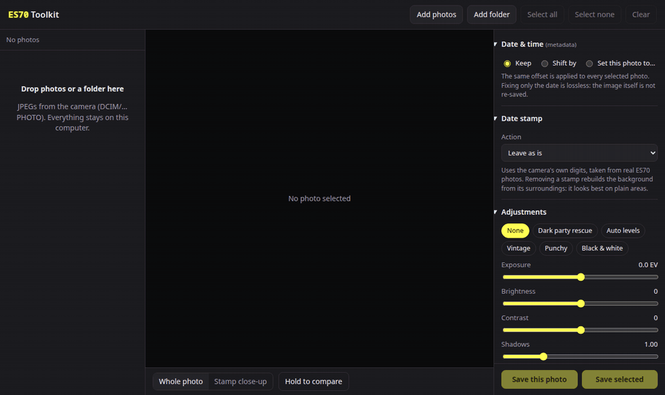
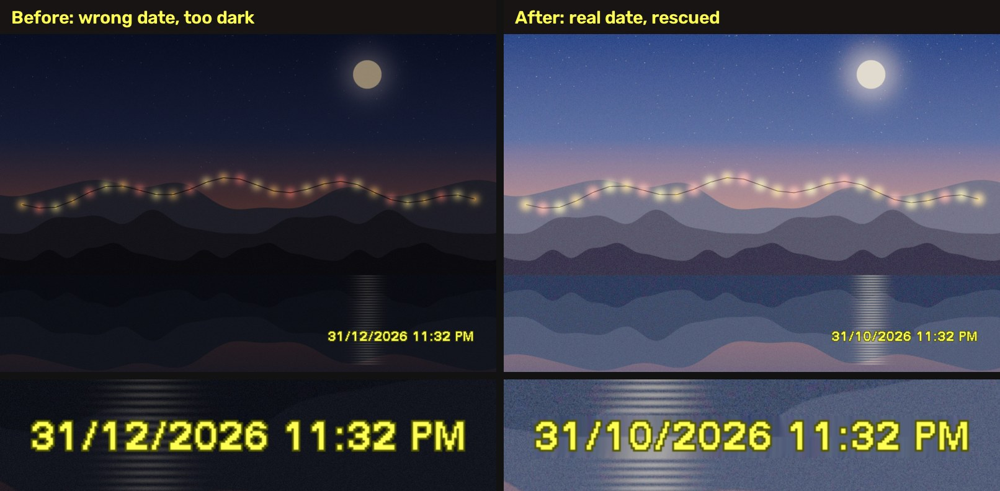

# ES70 Toolkit

A small, offline web app to fix and tweak photos from the **Samsung ES70** compact camera (also sold as ES71 / VLUU ES70 / SL600), one by one or in batch.

It was born from a real problem: the camera's clock got reset, every photo for weeks came out dated two months in the future, and the wrong date was burned into the pictures as the yellow date stamp. This app fixes both the metadata and the stamp itself.

Everything runs in your browser. Photos never leave your computer.

**▶ Try it: [stageddat.github.io/samsung-toolkit](https://stageddat.github.io/samsung-toolkit/)**





<sub>The demo picture is synthetic (generated for this README), stamped with the app itself.</sub>

> **Vibe coded.** This project was written by [Claude](https://claude.com/claude-code) (Anthropic's AI) in a single conversation, guided and tested on real photos by its owner. Read the code before trusting it with your only copy of anything, and keep backups.

## Features

**Date & time (EXIF)**
- Shift dates by days / hours / minutes, or set the real date of one photo and apply the same offset to every selected photo.
- Date-only changes are lossless: the image data is copied byte for byte, only the date fields are rewritten.
- Dates are handled as wall-clock times, so no surprise one-hour shifts around daylight saving changes.

**Date stamp**
- Add, replace or remove the yellow camera date stamp.
- Uses the camera's own glyphs, extracted from real ES70 photos, so a new stamp looks like the original.
- Formats `DD/MM/YYYY`, `YYYY/MM/DD`, `MM/DD/YYYY`; date only or date + time; 12 h (AM/PM) or 24 h.
- Position like the camera, or in any corner, at any size.
- Removal rebuilds the background from the surrounding pixels (inpainting).

**Adjustments**
- Presets: *Dark party rescue* (lifts very dark flash-less shots), *Auto levels*, *Vintage*, *Punchy*, *Black & white*.
- Exposure, brightness, contrast, shadows, saturation, warmth, fade, edge-preserving noise reduction, tone curves.

**Output**
- Resize to the camera's sizes (12M, 5M, 3M, 1M), rotate, choose JPEG quality.
- Save one photo, or the selection as a ZIP (or straight into a folder in Chromium-based browsers).
- The original EXIF block is kept, including Samsung's MakerNote, with updated date, dimensions and a regenerated embedded thumbnail.

**Viewer**
- Before/after compare (hold the button or the `C` key), stamp close-up, keyboard navigation (arrows, space to select).

## Usage

Use the [hosted version](https://stageddat.github.io/samsung-toolkit/) (still 100% local: the page is static and processes photos in your browser), or run it from a clone. No build step, no server, no install.

```sh
git clone https://github.com/stageddat/samsung-toolkit.git
xdg-open samsung-toolkit/index.html   # or just open it in your browser
```

Then drop photos (or the whole `DCIM/xxxPHOTO` folder) onto the page, pick a photo, adjust the settings on the right and save. Settings apply to every photo you save; select several (click the checkbox, Ctrl+click or Shift+click) to process them in batch.

Typical fix for a camera with a wrong clock:

1. Load the affected photos and select them all.
2. **Date & time → Set this photo to…** and type the real date of the current photo.
3. **Date stamp → Replace existing stamp** (if the photos have the stamp).
4. **Save selected**.

## How it works

- `js/exif.js`: a tiny JPEG/EXIF parser and writer. Instead of rebuilding metadata, it patches the original APP1 segment in place (dates are fixed-length strings), then transplants it into the newly encoded JPEG. That keeps camera-specific data intact. It also rebuilds the camera's file layout: an MPF index (APP2), Samsung's private APP15 block and a fresh 640×480 "screennail" appended after the main image. The camera's playback relies on that preview; without it, browsing edited photos on the camera becomes very slow.
- `js/stamp.js`: draws the stamp from the glyph bitmaps in `font.js`, scaled from the camera's 4000×3000 frame. Detection looks for the stamp's yellow ink wrapped in its dark olive outline at the known position. Removal masks the whole stamp, then fills it outside-in from real background pixels (a simplified Telea inpaint), so neighbouring letters don't bleed into the fill.
- `js/adjust.js`: tone adjustments via a lookup table (monotone cubic curves, levels, gamma, contrast, fade), plus saturation, warmth and a cheap bilateral-style denoiser.
- `font.js`: the stamp font: per-glyph advance widths plus bit-packed fill and outline masks. It was built with `tools/build_font.py`, which averages every occurrence of each character across real stamped photos (using their EXIF date to know which character is where) and drops pieces of neighbouring glyphs.
- `vendor/jszip.min.js`: [JSZip](https://stuartk.com/jszip) 3.10.1 for ZIP export.

### Rebuilding the font

You only need this to support another camera or a different stamp:

```sh
pip install numpy opencv-python-headless   # and have exiv2 installed
python tools/build_font.py /path/to/original/stamped/photos font.json
```

Then wrap the JSON as `window.STAMP_FONT = {...};` in `font.js`. The script assumes the ES70 layout at 4000×3000; adjust the constants at the top for other cameras.

## Limitations

- Stamp geometry was measured on 12M (4000×3000) photos. At other sizes it is scaled proportionally, which may be a few pixels off from where the camera would put it.
- Stamp removal looks great on plain backgrounds (walls, sky, darkness) and shows a soft patch on faces or detailed textures.
- JPEG photos only; the camera's `.AVI` videos are not supported.
- Large batches are processed one by one in the browser; 12M photos take a moment each.

## Privacy

There is no network access at runtime: no analytics, no uploads, no external requests. Open the browser's network tab and check for yourself.

## License

[GNU AGPL-3.0](LICENSE). You can use, study, change and share it; if you distribute it or run a modified version as a service, you must publish your source under the same license.

Bundled: [JSZip](https://github.com/Stuk/jszip) 3.10.1 (MIT or GPLv3), in `vendor/`.

A note on AI-written code: copyright in purely machine-generated material is legally unsettled (in some jurisdictions it may not be protectable at all). The license covers whatever parts of this project are protectable, including the human direction, selection and testing that went into it.
